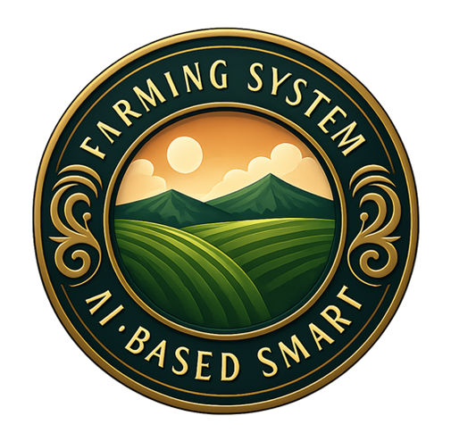
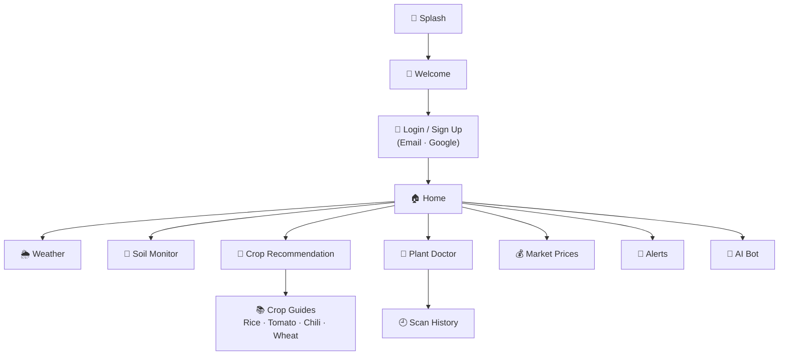
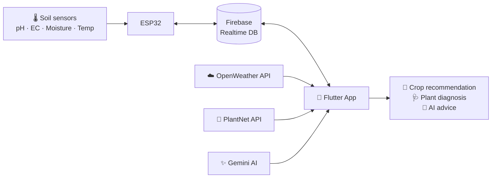

<div align="center">

<table align="center">
  <tr>
    <td align="center" valign="middle">
      
    </td>
    <td align="left" valign="middle">
      <h1>Smart Farming</h1>
      <span style="font-size:22px">🌱 🌾 🌿 🍃 🚜 💧 ☀️ 🌱</span>
    </td>
  </tr>
</table>

**Grow smarter with real-time data and AI.**
<br>
Crop recommendations · Plant disease detection · Live soil monitoring · AI farming assistant

<br>


<br>

[🎬 Demo](#-demo) &nbsp;•&nbsp; [✨ Features](#-features) &nbsp;•&nbsp; [📸 Screenshots](#-screenshots) &nbsp;•&nbsp; [🧭 App Flow](#-app-flow) &nbsp;•&nbsp; [🧠 How It Works](#-how-it-works) &nbsp;•&nbsp; [🚀 Getting Started](#-getting-started)

</div>

---

## 📖 Overview

**What if farmers could make smarter decisions using real-time data and AI?**

Smart Farming is a cross-platform mobile app built with **Flutter** and **IoT sensors** that helps farmers make data-driven decisions, **without needing prior agricultural knowledge**. It combines live soil readings, local weather and AI to answer the questions that matter most:

- 🌾 *Which crop should I plant right now?*
- 🧪 *What is the condition of my soil?*
- 🍃 *Is my plant sick, and what should I do?*

The goal is higher productivity, fewer crop losses and wider adoption of smart agriculture. The app is available in **English, Sinhala (සිංහල) and Tamil (தமிழ்)**.


<div align="center">

| 🌾 **4 soil parameters** | 🔥 **Real-time IoT** | 🤖 **3 AI / data APIs** | 🌍 **3 languages** |
|:---:|:---:|:---:|:---:|
| pH · EC · Moisture · Temp | ESP32 → Firebase → App | Gemini · PlantNet · OpenWeather | English · සිංහල · தமிழ் |

</div>

---

## 🎬 Demo

<div align="center">

<video src="https://github.com/user-attachments/assets/ed5f4233-6da0-430d-8c8d-adeafe1769ee" width="270" height="480" controls muted playsinline preload="metadata">
  Your browser does not support embedded video.
</video>

▶️ *Press play to watch the app in action. If the player doesn't load, [open the video directly](https://github.com/user-attachments/assets/ed5f4233-6da0-430d-8c8d-adeafe1769ee).*

</div>

---

## ✨ Features

| | Feature | Description |
|---|---|---|
| 🌾 | **Crop Recommendation** | Combines soil data (pH, EC, moisture, temperature), live weather and soil type to suggest the most suitable crops. Manual input is available when no sensor is connected. |
| 📡 | **Live Soil Monitoring** | Animated gauges for pH, EC, soil moisture and soil temperature, streamed from an ESP32 sensor node through Firebase Realtime Database. |
| 🌦️ | **Weather Insights** | Current conditions and forecast for the farm location through the OpenWeather API. |
| 🍃 | **Plant Doctor** | Take or upload a plant photo and get an instant identification through the PlantNet API. Past results are saved in **Scan History**. |
| 🤖 | **AI Assistant** | A Gemini-powered chatbot that answers farming questions in plain language. |
| 📚 | **Crop Guides** | Detail pages for crops such as rice, tomato, chili and wheat. |
| 💰 | **Market Prices** | A dedicated page for checking crop prices. |
| 🔔 | **Alerts** | In-app notification centre. |
| 🔐 | **Authentication** | Email/password and Google sign-in through Firebase Auth, with password reset. |
| 🌍 | **Multilingual** | English, Sinhala and Tamil, switchable inside the app. |

---

## 📸 Screenshots

<p align="center"><i>A quick look at the app, from sign-in to crop recommendations.</i></p>

<div align="center">

<table>
  <tr>
    <td></td>
    <td></td>
    <td></td>
    <td></td>
  </tr>
  <tr>
    <td></td>
    <td></td>
    <td></td>
    <td></td>
  </tr>
  <tr>
    <td></td>
    <td></td>
    <td></td>
    <td></td>
  </tr>
  <tr>
    <td></td>
    <td></td>
    <td></td>
    <td></td>
  </tr>
  <tr>
    <td></td>
  </tr>
</table>

</div>

---

## 🧭 App Flow



---

## 🧠 How It Works



1. Tapping **sample** in the app sets a flag in Firebase, which triggers the ESP32 to take fresh readings.
2. The ESP32 writes the readings to `SensorData`, and the app displays them live on the gauges.
3. The app combines the readings with local weather to produce a crop recommendation.
4. Plant photos are sent to PlantNet for identification, and Gemini answers follow-up questions in chat.

### Crop scoring (Python module)

The repository also includes a standalone Python module that scores each crop out of **9 points** based on:

- **Soil (4 pts):** pH, moisture, soil temperature and EC each fall inside the crop's ideal range.
- **Weather (4 pts):** share of forecast days with ideal temperature and ideal rainfall.
- **Season (1 pt):** whether the upcoming months match the crop's planting window.

Crops are returned ranked by score. The built-in database covers Tomato, Rice and Carrot and is easy to extend in `crop_module.py`.

---

## 🛠️ Tech Stack

| Layer | Technology |
|---|---|
| **Mobile app** | Flutter, Dart, Provider, `syncfusion_flutter_gauges`, `sqflite`, `shared_preferences`, `image_picker`, `geolocator` |
| **Backend / data** | Firebase Auth, Cloud Firestore, Firebase Realtime Database |
| **AI & APIs** | Google Gemini, PlantNet, OpenWeather |
| **IoT hardware** | ESP32, pH sensor, soil moisture sensor, temperature & humidity sensor, EC sensor |
| **Python module** | Flask, Requests (crop scoring and weather API) |
| **Localisation** | Flutter `gen-l10n` (`en`, `si`, `ta`) |

---

## 📂 Project Structure

```
Smart-Farming/
├── lib/
│   ├── main.dart              # App entry point, routes, localisation
│   ├── screens/               # Splash, auth, home, soil, weather, crop, doctor, chatbot, prices...
│   ├── services/              # Auth and Gemini services
│   ├── provider/              # Language state
│   ├── widgets/               # Reusable UI components
│   └── l10n/                  # English / Sinhala / Tamil translations
├── assets/                    # Logo and backgrounds
├── android/  ios/             # Platform projects
├── app.py                     # Flask API: /recommend_crops?lat=&lon=
├── main.py                    # CLI crop recommendation demo
├── crop_module.py             # Crop database and suitability scoring
├── weather_fetcher.py         # OpenWeather current + forecast helper
├── requirements.txt           # Python dependencies
└── pubspec.yaml               # Flutter dependencies
```

---

## 🚀 Getting Started

### Prerequisites

- [Flutter SDK](https://docs.flutter.dev/get-started/install) 3.x (Dart `>=3.0.0 <4.0.0`)
- A [Firebase](https://console.firebase.google.com/) project
- API keys for [OpenWeather](https://openweathermap.org/api), [PlantNet](https://my.plantnet.org/) and [Google Gemini](https://aistudio.google.com/)
- *(Optional)* Python 3.9+ for the backend module
- *(Optional)* An ESP32 with the soil sensors for live readings

### 1. Clone and install

```bash
git clone https://github.com/<your-username>/Smart-Farming.git
cd Smart-Farming
flutter pub get
```

### 2. Set up Firebase

1. Create a Firebase project and enable **Authentication** (Email/Password and Google), **Cloud Firestore** and **Realtime Database**.
2. Connect the app using the FlutterFire CLI:
   ```bash
   dart pub global activate flutterfire_cli
   flutterfire configure
   ```
3. Add your `google-services.json` to `android/app/`.

### 3. Add your API keys

Add your own keys in these files:

| Service | File |
|---|---|
| OpenWeather | `lib/screens/weather_page.dart` |
| PlantNet | `lib/screens/doctor_page.dart` |
| Gemini | `lib/screens/chatbot_page.dart` |

> ⚠️ **Never commit real API keys to a public repository.** Keep them out of source control, for example with `--dart-define` or a git-ignored config file.

### 4. Run the app

```bash
flutter run
```

### 5. (Optional) Run the Python module

```bash
pip install -r requirements.txt

# Set OPENWEATHER_API_KEY in config.py, then either:
python main.py        # interactive CLI
python app.py         # REST API on http://localhost:8000
```

Example request:

```
GET /recommend_crops?lat=6.9271&lon=79.8612
```

### 6. (Optional) IoT setup

The ESP32 firmware should:

- Watch `SensorData/sampling` in Firebase Realtime Database.
- When it is `true`, read the sensors and write `pH`, `ec_value`, `humidity`, `temperature` and `sampling: false` back to `SensorData`.

---

## 🗺️ Roadmap

- [ ] Train an ML model for crop prediction (scikit-learn)
- [ ] Add more crops to the recommendation database
- [ ] Offline mode for low-connectivity areas
- [ ] Irrigation and fertiliser scheduling
- [ ] Historical sensor analytics and charts

---

## 🤝 Contributing

Contributions are welcome!

1. Fork the repository
2. Create a branch: `git checkout -b feature/amazing-feature`
3. Commit your changes: `git commit -m "Add amazing feature"`
4. Push the branch: `git push origin feature/amazing-feature`
5. Open a Pull Request

---

<div align="center">

**Made with 💚 for farmers**

*If you find this project useful, please consider giving it a ⭐*

</div>
